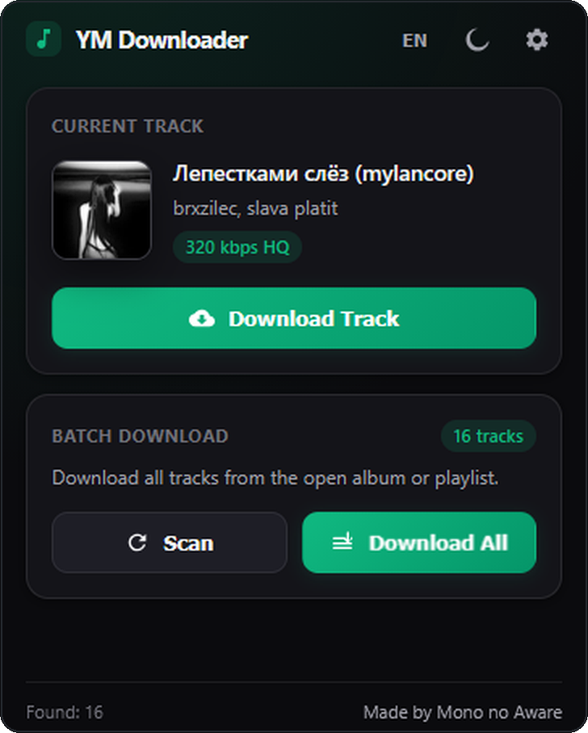
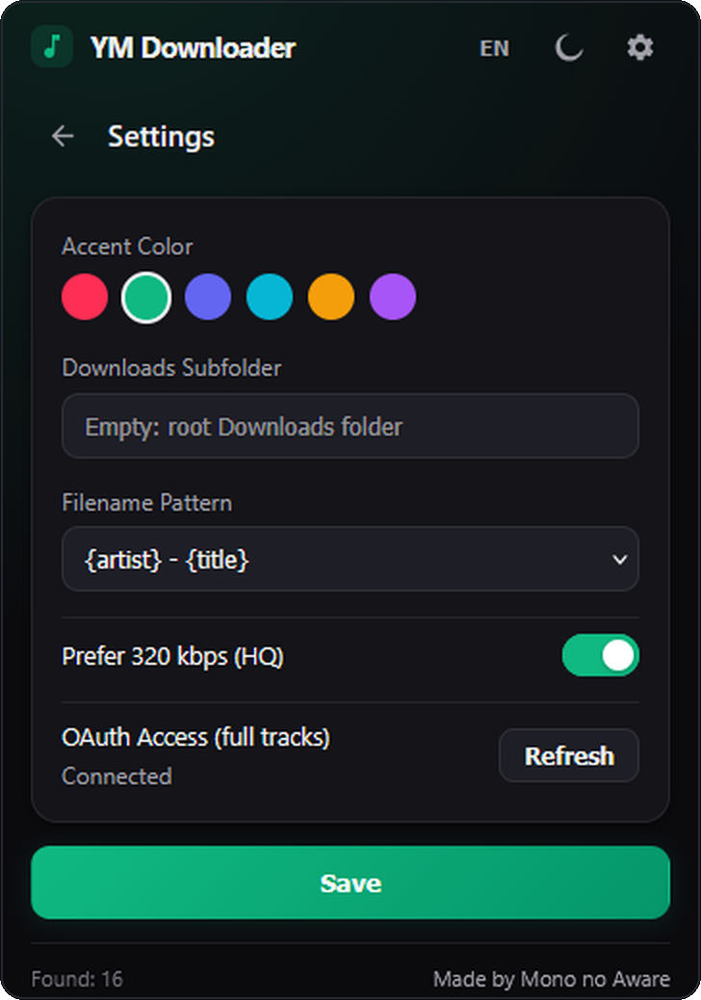
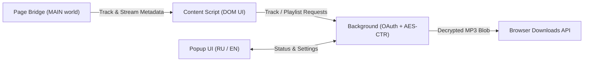

<div align="center">

# YM Downloader

**Minimalist cross-browser extension for Chrome & Firefox to download full tracks, albums, and playlists from Yandex Music in up to 320 kbps.**

**English** | [Русский](README.ru.md)


</div>

---

## Preview

<p align="center">
  
  &nbsp;&nbsp;&nbsp;&nbsp;
  
</p>

---

## Features

- **One-Click Track Downloads** — Integrated download buttons right inside track lists and the bottom player bar.
- **Batch Album & Playlist Downloading** — Scan and download entire open albums or playlists with a live progress bar.
- **Full Tracks (Up to 320 kbps HQ)** — Uses Yandex OAuth (`oauth.yandex.ru`) and client-side `encraw` AES-CTR stream decryption so you get full tracks instead of 30-second previews.
- **Themes & Accent Colors** — Dark and Light modes with 6 accent colors (Rose, Emerald, Indigo, Cyan, Amber, Violet).
- **Bilingual UI** — Instant `EN` / `RU` switcher in the popup header.
- **Flexible Output** — Custom subfolder inside Downloads and filename templates (`{artist}`, `{title}`, `{album}`).

---

## Architecture

| Component | Responsibility | Files |
| :--- | :--- | :--- |
| **Page Bridge** | Runs in `MAIN` world on Yandex Music to capture playback metadata and stream keys. | `content/page-bridge.js` |
| **Content Script** | Injects inline download buttons into track rows/player and scans albums/playlists. | `content/content.js`, `content/content.css` |
| **Background** | Handles Yandex OAuth, resolves track URLs, decrypts `encraw` AES-CTR streams, and saves files via `downloads` API. | `background.js`, `lib/md5.js` |
| **Popup UI** | Displays current track, batch download controls, progress bar, theme/color settings, and RU/EN switcher. | `popup/popup.html`, `popup/popup.css`, `popup/popup.js` |



---

## Installation

### Option 1: From GitHub Releases (Recommended)

1. Download the archive for your browser on the [Releases](https://github.com/Mono-no-Awares/ym-downloader-extension/releases) page:
   - **Chrome / Brave / Edge / Yandex Browser**: `ym-downloader-chrome.zip`
   - **Firefox**: `ym-downloader-firefox.zip`
2. **Chrome / Brave / Edge / Yandex Browser**:
   - Extract `ym-downloader-chrome.zip` into a folder.
   - Open `chrome://extensions/` and enable **Developer mode**.
   - Click **Load unpacked** and select the extracted folder.
3. **Firefox**:
   - Open `about:debugging#/runtime/this-firefox`.
   - Click **Load Temporary Add-on…** and select `ym-downloader-firefox.zip` (or extract it and select `manifest.json`).
   - *(Temporary add-ons reset on restart. For permanent installation: sign as an Unlisted add-on on AMO, or in Developer Edition / Nightly / LibreWolf set `xpinstall.signatures.required` to `false` in `about:config` and install the `.zip` renamed to `.xpi`.)*

### Option 2: Build from Source

```bash
python build.py
```

Generates unpacked directories (`dist/chrome/`, `dist/firefox/`) and `.zip` archives in `dist/`.

---

## Author & License

- Created by **Mono no Aware** — [github.com/Mono-no-Awares](https://github.com/Mono-no-Awares)
- Licensed under the [MIT License](LICENSE).
