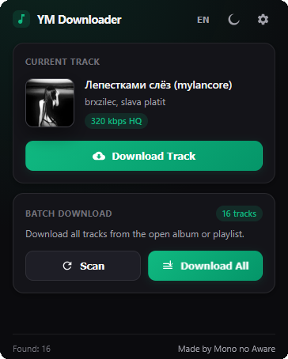
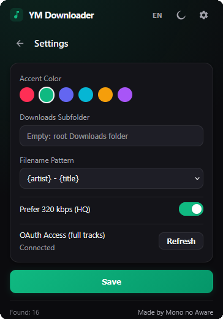

# YM Downloader

Cross-browser Manifest V3 extension for Google Chrome and Mozilla Firefox to download full tracks and playlists from Yandex Music in high quality (up to 320 kbps).

Made by [Mono no Aware](https://github.com/Mono-no-Awares)

[English](#english) · [Русский](#русский)

## Preview

<p align="center">
  
  &nbsp;&nbsp;
  
</p>

---

## English

### Features
- **One-click download** from track lists and the bottom player bar
- **Batch downloading** for open albums and playlists with live progress bar
- **Full-track support** via Yandex OAuth (`oauth.yandex.ru`) and `encraw` AES-CTR stream decryption
- **Themes & Accent Colors**: Dark / Light modes + 6 accent colors (Rose, Emerald, Indigo, Cyan, Amber, Violet)
- **Bilingual UI**: instant `EN` / `RU` switcher
- **Flexible output**: custom subfolder in Downloads and filename templates (`{artist}`, `{title}`, `{album}`)

### Installation

#### Chrome / Brave / Edge / Yandex Browser
1. Download `ym-downloader-chrome.zip` from **Releases** (or run `python build.py`).
2. Extract the archive, open `chrome://extensions/`, and enable **Developer mode**.
3. Click **Load unpacked** and select the extracted folder (or `dist/chrome`).

#### Mozilla Firefox
1. Download `ym-downloader-firefox.zip` from **Releases** (or run `python build.py`).
2. Open `about:debugging#/runtime/this-firefox`.
3. Click **Load Temporary Add-on...** and select `manifest.json` inside the extracted folder (or `dist/firefox/manifest.json`).

### Build from Source
```bash
python build.py
```
Outputs unpacked builds and `.zip` archives into `dist/`.

---

## Русский

### Возможности
- **Скачивание в один клик** — кнопки в списке треков и на панели плеера
- **Пакетная загрузка** — скачивание целых альбомов и плейлистов с прогресс-баром
- **Полные треки (не 30-сек превью)** — поддержка Yandex OAuth (`oauth.yandex.ru`) и расшифровка `encraw` (AES-CTR) для играющего потока
- **Темы и цвета** — тёмная и светлая темы + 6 акцентных цветов (Rose, Emerald, Indigo, Cyan, Amber, Violet)
- **Языки** — быстрое переключение `RU` / `EN`
- **Гибкое сохранение** — своя подпапка в Загрузках и шаблоны имён (`{artist}`, `{title}`, `{album}`)

### Установка

#### Chrome / Brave / Edge / Яндекс Браузер
1. Скачай `ym-downloader-chrome.zip` из раздела **Releases** (или выполни `python build.py`).
2. Распакуй архив, открой `chrome://extensions/` и включи **Режим разработчика**.
3. Нажми **Загрузить распакованное расширение** и выбери папку с расширением (или `dist/chrome`).

#### Mozilla Firefox
1. Скачай `ym-downloader-firefox.zip` из раздела **Releases** (или выполни `python build.py`).
2. Открой `about:debugging#/runtime/this-firefox`.
3. Нажми **Загрузить временное дополнение...** и выбери `manifest.json` из распакованной папки (или `dist/firefox/manifest.json`).

### Сборка из исходников
```bash
python build.py
```
Собирает готовые папки и `.zip`-архивы в `dist/`.

---

## License
MIT
