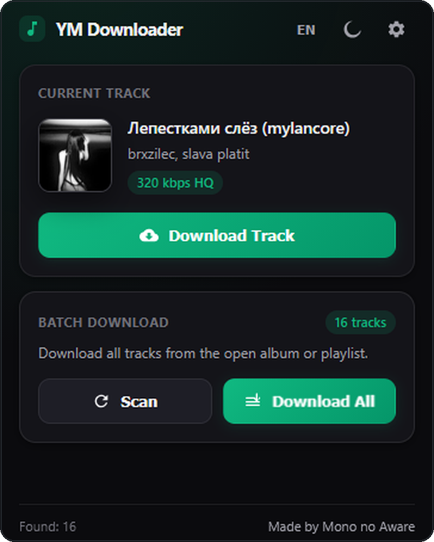
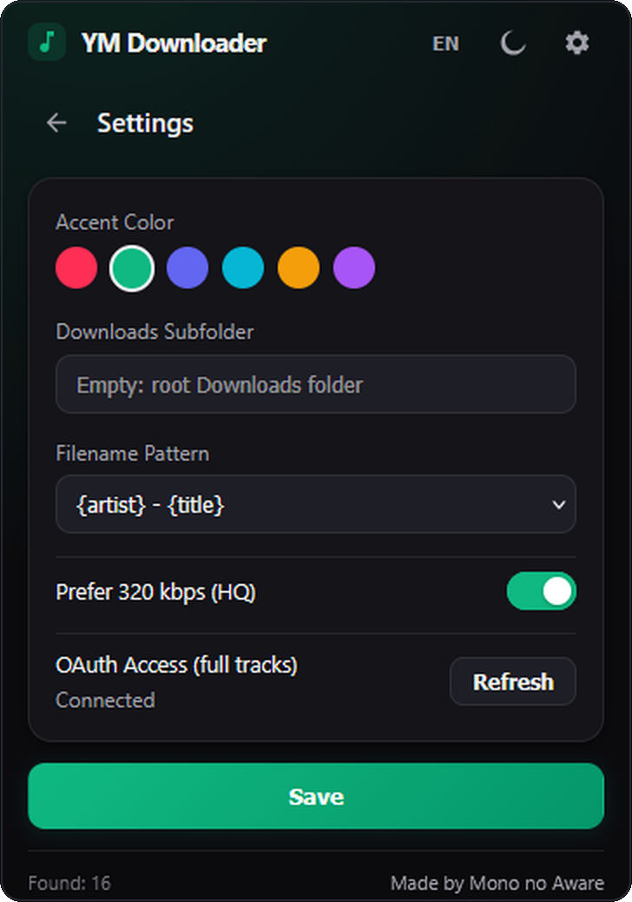
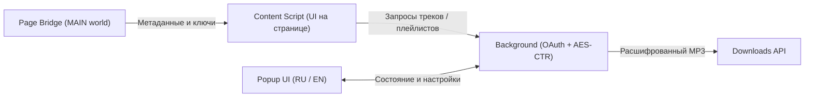

<div align="center">

# YM Downloader

**Минималистичное расширение для Chrome и Firefox для скачивания полных треков, альбомов и плейлистов с Яндекс Музыки в качестве до 320 kbps.**

[English](README.md) | **Русский**


</div>

---

## Превью

<p align="center">
  
  &nbsp;&nbsp;&nbsp;&nbsp;
  
</p>

---

## Возможности

- **Скачивание в один клик** — встроенные кнопки прямо в списке треков и на нижней панели плеера.
- **Пакетная загрузка** — скачивание целых открытых альбомов и плейлистов с живым прогресс-баром.
- **Полные треки (до 320 kbps HQ)** — поддержка Yandex OAuth (`oauth.yandex.ru`) и расшифровка потока `encraw` (AES-CTR) вместо 30-секундных превью.
- **Темы и акцентные цвета** — тёмная и светлая темы + 6 цветов (Rose, Emerald, Indigo, Cyan, Amber, Violet).
- **Двуязычный интерфейс** — мгновенное переключение `RU` / `EN` в шапке попапа.
- **Гибкое сохранение** — своя подпапка в Загрузках и шаблоны имён (`{artist}`, `{title}`, `{album}`).

---

## Архитектура

| Модуль | За что отвечает | Файлы |
| :--- | :--- | :--- |
| **Page Bridge** | Работает в `MAIN` world на Яндекс Музыке и перехватывает метаданные и ключи потока. | `content/page-bridge.js` |
| **Content Script** | Встраивает кнопки скачивания в интерфейс и сканирует открытые альбомы/плейлисты. | `content/content.js`, `content/content.css` |
| **Background** | Работает с Yandex OAuth, получает ссылки, расшифровывает `encraw` (AES-CTR) и сохраняет файлы через `downloads` API. | `background.js`, `lib/md5.js` |
| **Popup UI** | Показывает текущий трек, пакетную загрузку, прогресс, настройки тем/цветов и переключатель `RU / EN`. | `popup/popup.html`, `popup/popup.css`, `popup/popup.js` |



---

## Установка

### Вариант 1: Из GitHub Releases (рекомендуется)

1. Скачайте архив для вашего браузера со страницы [Releases](https://github.com/Mono-no-Awares/ym-downloader-extension/releases):
   - **Chrome / Brave / Edge / Яндекс Браузер**: `ym-downloader-chrome.zip`
   - **Firefox**: `ym-downloader-firefox.zip`
2. **Chrome / Brave / Edge / Яндекс Браузер**:
   - Распакуйте `ym-downloader-chrome.zip` в любую папку.
   - Откройте `chrome://extensions/` и включите **Режим разработчика**.
   - Нажмите **Загрузить распакованное расширение** и выберите распакованную папку.
3. **Firefox**:
   - Откройте `about:debugging#/runtime/this-firefox`.
   - Нажмите **Загрузить временное дополнение…** и выберите `ym-downloader-firefox.zip` (либо распакуйте и укажите `manifest.json`).
   - *(Временные дополнения сбрасываются после перезапуска. Для постоянной установки: подпишите архив как Unlisted на AMO, либо в Firefox Developer Edition / Nightly / LibreWolf переключите `xpinstall.signatures.required` в `false` в `about:config` и установите `.zip`, переименованный в `.xpi`.)*

### Вариант 2: Сборка из исходников

```bash
python build.py
```

Собирает готовые папки (`dist/chrome/`, `dist/firefox/`) и `.zip`-архивы в `dist/`.

---

## Автор и лицензия

- Автор: **Mono no Aware** — [github.com/Mono-no-Awares](https://github.com/Mono-no-Awares)
- Распространяется под лицензией [MIT](LICENSE).
